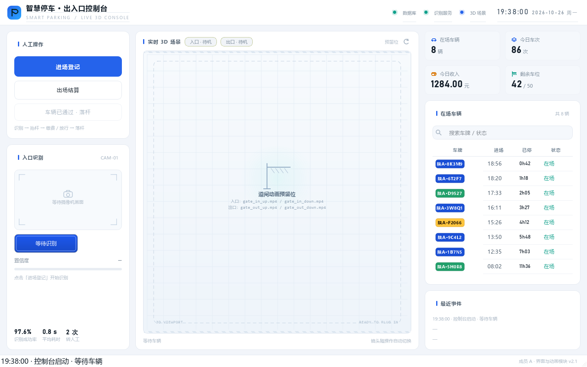
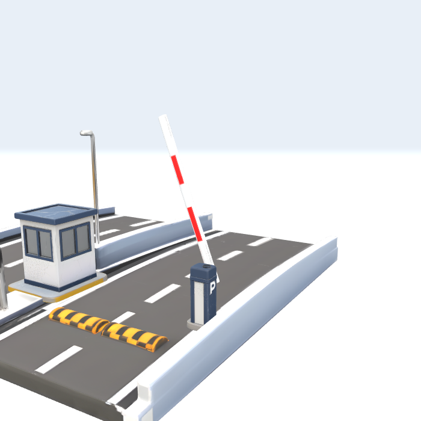
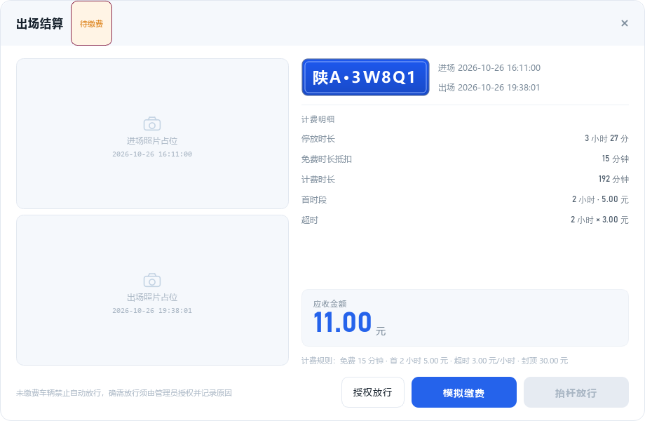

# 成员 A 交付说明：界面 / 实时 3D / 道闸动画

> 版本 v2.1 · 交付给组长做整合 · 2026-10

对应分工表：**A-01 场景整理 / A-02 动画导出 / A-03 动画接口 / A-04 主界面 /
A-05 出场缴费界面 / A-06 演示视频**。

一句话：**主界面 + 实时 3D 场景 + 道闸动画接口 + 出场结算窗口**，
接上真实服务（识别、数据库、计费）后不用改界面代码。







---

## 1. 运行

```bash
pip install -r requirements.txt
python app.py
```

| 项 | 说明 |
|---|---|
| Python | 3.9+（开发用 3.14 验证） |
| 系统 | Windows 10/11 |
| 依赖 | `PyQt5`；实时 3D 需要 `PyQtWebEngine`（不装会自动降级） |
| 数据 | 首屏数据来自 `parking/services/mock_service.py`，不依赖数据库 |
| 无资源 | 没有 `parking.glb`、没有视频时界面照常可跑（占位画面） |

可选环境变量：`ANIM_MODE=auto|webgl|video|sequence|placeholder`（默认 `auto`）。

---

## 2. 界面结构（三栏）

```
┌ 顶栏：品牌 / 三个状态灯 / 时钟 ─────────────────────────────────┐
├──────────────┬────────────────────────────┬────────────────────┤
│ 人工操作 302  │      实时 3D 场景（弹性）    │   停车场数据 382    │
│ 进场登记      │                            │ 指标卡 2×2          │
│ 出场结算      │  一个 three.js 页面         │ 在场车辆（8 行）     │
│ 车辆已通过·落杆│  入口 / 出口共用一台镜头     │ 最近事件            │
│ 入口识别      │                            │                    │
└──────────────┴────────────────────────────┴────────────────────┘
```

- 配色、字体、圆角全部在 `parking/ui/theme.py`，换肤只改这一个文件；
- 窗口最小 1200×720；两侧固定宽，中间自适应；
- 落杆按钮：没有闸杆抬起时禁用，抬杆后变蓝启用，落杆过程中再次禁用。

---

## 3. 实时 3D 场景

Blender 场景导出成 glTF，QtWebEngine 里用 three.js 渲染。业务触发后：

```
raise_gate("in")
   → 镜头飞到入口机位（0.9 s 缓动）
   → 播放 gate_in_open
   → 播完回调 Python → 状态变「已抬起」→ 触发 raised("in")
```

### 3.1 资源规范（`resources/model/`）

| 内容 | 要求 |
|---|---|
| `parking.glb` | Blender 导出的 glTF 2.0 二进制 |
| 动画名 | `gate_in_open` / `gate_in_close` / `gate_out_open` / `gate_out_close` |
| 机位（可选） | 摄像机或空物体，命名 `cam_in` / `cam_out` / `cam_wide` |
| 取景兜底 | 没有机位时，按 `gate_in` / `gate_out` 节点自动生成四分之三侧机位 |

- 动画长度不敏感：播放时按 `clip.duration / 1.8s` 自动压缩，10 秒的动画也能在 1.8 秒内播完；
- 画面比例不敏感：镜头按画布宽高比自动后退，窄画面也能把道闸框全；
- 导出步骤、命名规则、画面建议见 `resources/model/README.txt`。

### 3.2 降级链路

```
parking.glb 存在且 WebEngine 可用 → 实时 3D
        ↓ 10 秒内没就绪 / 页面报错
gate_*.mp4 → 序列帧 → 占位画面
```

任何一层失败都不会卡死，业务信号照常发出，道闸状态照常流转。

---

## 4. 备用动画资源（不用 3D 时）

| 道闸 | 抬杆 | 落杆 |
|---|---|---|
| 入口 | `resources/anim/gate_in_up.mp4` | `resources/anim/gate_in_down.mp4` |
| 出口 | `resources/anim/gate_out_up.mp4` | `resources/anim/gate_out_down.mp4` |

也可用 PNG 序列：`anim/in/up/*.png`、`in/down/*.png`、`out/up/*.png`、`out/down/*.png`。
参数与「镜头归位」前导片规则见 `resources/anim/README.txt`。

---

## 5. 代码结构

```
parking_system/
├── app.py                     启动入口（主题、图标、ANIM_MODE）
├── requirements.txt
├── parking/
│   ├── ui/
│   │   ├── theme.py           设计令牌 + 全局 QSS（浅色）
│   │   ├── icons.py           纯代码绘制的线性图标
│   │   ├── widgets.py         卡片 / 车牌牌面 / 指标卡 / 胶囊 / 提示气泡
│   │   ├── scene_panel.py     实时 3D 场景面板（对外只暴露 raise/lower）
│   │   ├── main_window.py     三栏主界面 + 业务流程
│   │   └── exit_dialog.py     出场结算（无边框自绘）
│   ├── anim/
│   │   ├── base.py            GateAnimator 接口（业务只依赖它）
│   │   ├── webgl.py           实时 3D 实现（QWebEngine + QWebChannel 桥）
│   │   ├── video.py           MP4 实现
│   │   ├── sequence.py        序列帧实现
│   │   ├── placeholder.py     占位实现
│   │   └── __init__.py        create_animator()：按资源选实现
│   └── services/mock_service.py  演示数据 + 计费（与需求 1.3.3 一致）
├── viewer/                    three.js 页面（index.html / viewer.js / lib）
├── resources/
│   ├── model/                 parking.glb + 导出说明
│   └── anim/                  MP4 / 序列帧 + 说明
└── tools/                     截图、自测、Blender 导出脚本
```

---

## 6. 整合接口（组长看这里）

### 6.1 启动

```python
from parking.ui.main_window import MainWindow
from parking.services.mock_service import MockService

win = MainWindow(MockService(), "resources/anim", "auto")
win.show()
```

`MainWindow(service, anim_dir, anim_mode)` 只依赖 `service` 的下面几个方法，
把 `MockService` 换成真实服务即可，界面代码一行都不用改。

### 6.2 Service 契约

| 方法 | 返回 | 调用时机 | 对应真实模块 |
|---|---|---|---|
| `present_vehicles()` | `list[VehicleRow]` | 每 5 秒轮询 + 数据变化后立即调用 | `RecordRepository.list_present()` |
| `stats()` | `dict(present, today_count, today_income, free_spaces)` | 同上 | 统计服务 |
| `recognize()` | `(plate, confidence, kind)` | 点「进场登记」 | `LicenseRecognizer.recognize()` |
| `bill(plate)` | `Bill` | 点「出场结算」 | `ExitService.exit()` |
| `pay(plate, amount)` | — | 结算窗口点「模拟缴费」 | 支付服务 |
| `add_entry(plate, kind)` | — | 入口抬杆动画**结束后** | `EntryService.enter()` |
| `exit_vehicle(plate)` | — | 出口抬杆动画**结束后** | `ExitService` 结算完成 |

两个数据类（`parking/services/mock_service.py`，与详细设计 3.3.x 对齐）：

- `VehicleRow(plate, kind, enter_time, status)`，`kind ∈ {blue, yellow, green}`，
  `duration_min` 是现算属性；
- `Bill(plate, kind, enter_time, exit_time, minutes, free_minutes, first_hours,
  first_price, extra_price, day_cap, billable_minutes, extra_hours, total, capped, lines)`。

> 如果真实服务是异步的（数据库 / 网络），建议在服务内部用 QThread 或本地缓存，
> 保持这些方法**同步返回**——界面这边是同步调用的。

### 6.3 场景面板 API

```python
win.scene.raise_gate("in")      # 入口抬杆（镜头先归位再播动画）
win.scene.raise_gate("out")     # 出口抬杆
win.scene.lower_gate("in")      # 落杆
win.scene.lower_current()       # 落当前抬起的那道闸
win.scene.has_open_gate()       # 是否有闸杆还抬着

win.scene.raised     # 信号(str gate)：抬杆动画结束
win.scene.lowered    # 信号(str gate)：落杆动画结束
win.scene.open_changed  # 信号(bool)：有闸杆抬起/落下（接自动落杆用）
```

### 6.4 接入图像识别（自动化扩展点）

进场这一步已经拆成「取结果」和「处理结果」，外部拿到识别结果可以直接推进：

```python
# 识别服务（QThread 或定时器）吐出一个车牌
recognizer.recognized.connect(lambda plate, conf, kind: win._on_entry(plate, conf, kind))
```

`_on_entry(plate, conf, kind)` 不传参数时才会自己调 `service.recognize()`，
传了就跳过识别、直接走「抬杆 → 动画结束 → 写库」。

自动落杆同理，挂在场景信号上即可：

```python
from PyQt5.QtCore import QTimer
def arm_auto_close(opened):
    if opened:
        QTimer.singleShot(8000, win.scene.lower_current)   # 8 秒兜底，或接地感信号
win.scene.open_changed.connect(arm_auto_close)
```

> 现状：**抬杆 / 落杆都是手动按钮触发的**，接识别只是换触发源，业务流程不用动。

### 6.5 其他可用接口

- `win.capture.set_frame(QImage)`：喂真实摄像头画面（不喂就显示取景框）；
- `PhotoTile.set_image(path)`：结算窗口里的抓拍照片；
- `parking/ui/theme.py` 的 `qss()`：整站样式，改颜色只需改令牌。

---

## 7. 自测

```bash
python tools/selftest_anim.py      # 动画工厂与资源选择 → SELFTEST PASS
python tools/selftest_flow.py      # 两门联动 10 项断言 → RESULT PASS
python tools/viewer_test.py docs   # 3D 页面（加载 → 镜头 → 动画 → 回调 → 截图）
python tools/selftest_webgl.py docs# 整界面 + 3D（需要 WebEngine）
python tools/screenshot.py docs    # 生成 docs/ 下的界面截图
```

`selftest_flow.py` 覆盖：进场 +1、入口抬起、出口待机、落杆按钮启用、
落杆提示为「落杆中」、入口落杆复位、出场走出口、车辆移出列表、入口不受影响。

3D 页面还可以指定画面尺寸检查取景：`python tools/viewer_test.py docs 700x700`。

---

## 8. 已知边界

1. **模型偏大**：当前 `parking.glb` 约 125 MB，首次加载 1–3 秒、内存占用高；
   建议删无用物体、贴图压到 1024、导出勾选 Draco，通常可降到 10–20 MB。
2. **模型没有机位**：现在按 `gate_in/out` 节点自动取景；在 Blender 里补
   `cam_in` / `cam_out` / `cam_wide` 三台摄像机后可精确构图。
3. **无 WebEngine 时**中间是占位画面（不是黑屏），状态胶囊显示「预留位」。
4. 出场照片位目前是占位图，`PhotoTile.set_image(path)` 传入真实抓拍即可。
5. 界面高度依赖 1200×720 以上分辨率；更小的屏需要再压侧栏宽度。
6. 完整界面 + WebEngine 在无桌面会话 / 受限环境里可能起不来（Chromium 需要
   系统 IPC 与 GL 上下文），表现是 10 秒后自动降级并在卡片上提示；
   这种情况先用 `viewer_test.py` 单独验证 3D 页面，再到正常桌面上跑整界面。

---

## 9. 待办（成员 A 侧）

1. **A-06 演示视频**：按下表录屏，2 分钟。

| 时间 | 画面 | 旁白要点 |
|---|---|---|
| 0:00–0:15 | 主界面全景 | 三栏布局、3D 场景、在场数据 |
| 0:15–0:40 | 点「进场登记」 | 车牌、置信度、镜头飞向入口、抬杆 |
| 0:40–0:55 | 点「车辆已通过·落杆」 | 掩杆落下，状态回到待机 |
| 0:55–1:25 | 双击车辆 → 出场结算 | 计费明细、应收金额 |
| 1:25–1:45 | 模拟缴费 → 抬杆放行 | 镜头切到出口、抬杆、车辆离场 |
| 1:45–2:00 | 指标卡与事件 | 数据实时刷新、每条操作有留痕 |

2. **模型优化**：压缩 `parking.glb`，补三台机位摄像机（可选）。

---

## 10. 版本记录

| 版本 | 内容 |
|---|---|
| v1.0 | 深色双面板界面、视频/序列帧动画、出场结算 |
| v2.0 | 实时 3D（three.js + QtWebEngine）、浅色主题、单元自测 |
| v2.1 | 三栏布局（左操作 / 中 3D / 右数据）、落杆状态修正、整合接口整理 |
